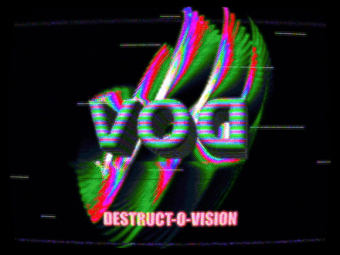
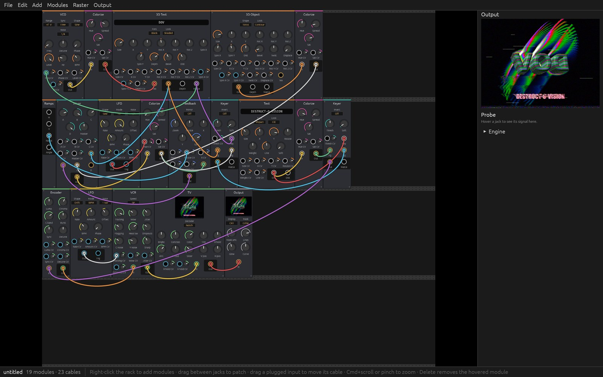

# Destruct-O-Vision

Destruct-O-Vision is a modular video synthesizer that emulates analog video. You patch it like VCV Rack. Instead of applying a VHS look as a filter, it models the signal chain itself: oscillators run in raster time, video passes as composite through a VCR, and a CRT has to lock onto its sync.

<p align="center">
  
</p>

The showcase patch, which the app opens with, works like this:
1. Spinning 3D letters are painted with an oscillator's color bars, over a contour-lit torus.
2. They swirl through feedback whose colors cycle.
3. Everything is encoded to composite video and played through a VCR, whose tracking drifts with an LFO.
4. A TV decodes the signal and shows it on a CRT.

The tearing, noise bars and soft color all come from the emulated signal, not from a filter. [Watch the full demo video](https://github.com/bradbrok/destruct-o-vision/releases/download/v0.1.1/destruct-o-vision-demo.mp4) (15 s, 60 fps).

**Status: pre-alpha.** The app has a VCV-style rack: modules sit on rails, and you patch them with cables. It ships with 51 modules:
- **Sources:** VCO, Ramps, Shape, Noise, a live Camera and a Movie player (macOS), Text, 3D Text, and 3D Object
- **Processing:** Mixer, Blend (two inputs, all of Photoshop's blend modes), VCA, Folder, Keyer, Chroma Key, a line-scan Filter, Blur (its radius takes video-rate CV, for blurring parts of the picture), Edge, Posterize
- **Color:** Colorize, RGB Combine/Split
- **Space & time:** Feedback frame store, Delay (echo, freeze, and slit-scan through its Time CV), Displace, Mirror, Mosaic, Tile (repeat, mirror or brick grids that scroll), Transform (zoom, rotate, stretch, move), Warp (swirl, bulge, ripple, wave), Polar (planet, tunnel, unwrap), Kaleido
- **Analog signal path:** Encoder, Inject, Cable, VCR, TBC, TV
- **Digital glitch:** Datamosh, Pixel Sort, JPEG (real compression, and corruption), Slice (tearing), Bits (bitwise ops between pictures)
- **Control:** LFO (Hz, or a note value on the global tempo; Trig output), Macros, Audio In (any connected input and channel, picked by name; a resonant low/band/high-pass filter into an envelope follower, with Gate and Trig), MIDI Notes (pitch, gate, velocity, trigger), MIDI CC (four controllers, with learn)
- **I/O:** Monitor, Output, CRT

**Movies.** Movie plays a movie file (anything QuickTime opens: H.264, HEVC, ProRes) in a loop from In to Out. Speed runs from 4× backward to 4× forward. Loop, Bounce or Once sets what happens at the ends. In Scrub mode, Position picks the frame, so an LFO or Audio In can scrub through the clip. FPS holds frames for a stop-motion look, and BPM sync fits the loop to a note value on the beat grid. Click the file row to choose a movie, or drop movie files onto the rack.

Click a Movie's picture to open its editor. Its timeline zooms in to single frames, so you can drag In and Out onto exactly the frame you want, hold the picture and step through it, or scrub. The editor also cuts the movie into splices, as on a Morphagene: Organize (knob and CV) picks the splice to play, Next steps on to the following one, and In and Out trim whichever splice is playing. Keys: space holds, the arrows step a frame (10 with shift), I and O set In and Out, S cuts a splice. Frames are decoded ahead of the playhead and kept in memory, so after its first pass a loop plays from memory, backward too.

**Warps and glitches.** Every knob on the warps takes video-rate CV, so a ramp into Transform's Rotate twists the picture and noise into Warp's Amount crumples it. Datamosh finds the motion in its input block by block and drags the old picture along with it, so a cut turns into a melt; turn Keyframe on to show the input clean, and off to start moshing. Pixel Sort sorts runs of pixels by brightness, hue, saturation or any signal patched into Key, in any of four directions. JPEG compresses each field for real, and Corrupt damages it the way a bad bit in a file does.

**3D and text.** 3D Object and 3D Text are raymarched per pixel, so a video signal patched into their rotation, twist or size CVs bends them line by line, and video patched into Tex paints their surfaces. Text renders whatever you type on its panel as a fill, outline, glow or contour bands, in system fonts.

**Tempo.** The tempo bar at the top right sets the patch's tempo: drag it, type it, or tap it in. It also shows the beat of the bar and chooses where the tempo comes from:
- **Internal:** the patch's own, saved with it.
- **Ableton Link:** joins Live's session, or any Link app's on this Mac or the network. Tempo changes go both ways, and bars line up. Turn Link on in Live's settings.
- **MIDI clock:** follows MIDI clock from any device, including song position. In Live, turn Sync on for a MIDI output, such as the IAC Driver.

LFOs in BPM mode, VCOs in the BPM range and Movies on BPM sync all follow it, each at its own note value.

**Patching rules.** Ring colors show what a jack carries: gray and amber are video, blue is control (one value per field), green is composite. A light beside each control output shows its level. Video can plug into blue jacks too; it arrives as the picture's average brightness, a field or two late. Feedback's CVs are video-rate, so a picture patched into them warps the feedback pixel by pixel.

Monitor, Output, Camera, Movie and TV show live pictures right in their panels.

**The output window.** Output shows the picture in it clean. Use CRT in its place for a picture tube, drawn at the window's own resolution and refresh rate:
- an electron beam with a round spot that blooms on bright parts;
- phosphors that decay at their own rates, in color or the white, green and amber of monochrome tubes;
- an aperture grille (damper wires and all), shadow mask or slot mask, at the dot pitch you set;
- halation in the glass, misconvergence toward the edges, curvature and overscan, and the room reflected in the glass.

On a display at a whole multiple of the field rate (120 Hz for NTSC, 100 Hz for PAL), Scan Beam shows each field being drawn top to bottom, as on a real tube. Power switches the set off into a fading dot and back on through a warm-up. Hold a Magnet to the screen for color blotches that stay until you press Degauss. H pos and V pos take video-rate CV, so a VCO can bend the raster like a wobbulator. Patches that used Output's old CRT setting open with a CRT.

**Picture size.** The Raster menu sets the size of the picture: NTSC or PAL, or a size made for a screen. Horizontal goes from 720p to 4K, vertical for phones from 720×1280 to 4K (1080×1920 for Reels, TikTok and Shorts), and there's square and 4:5 portrait. These sizes run at 24, 25, 30, 50 or 60 frames a second, or type any size from 32 to 4096 pixels a side. The patch saves its size, and `--raster 1080x1920p30` picks one at launch. Movies and snapshots come out at the raster's size, and at least 1080 lines tall. Only NTSC and PAL carry color through composite, so on the other sizes the Encoder, VCR and TV are black and white.

**The analog signal path (Phase 2) works.** The Encoder turns RGB into a real composite waveform with sync pulses, color burst and modulated chroma. Composite cables (green) carry that waveform through a VCR and a Cable into a TV.

The TV has to lock onto the signal, using a sync separator, a line oscillator with AFC and a field oscillator with V hold. Rolling, tearing, flagging and lost color come from the signal itself. For example, push an oscillator into the sync with Inject and the picture falls apart.



Built-in demo patches (also on the File menu):
- `--demo showcase` (the default)
- `--demo feedback`
- `--demo analog`
- `--demo time` (delays and chroma key)
- `--demo lab` (3D text over swirling feedback, with video driving a control jack)
- `--demo glitch` (a spinning torus datamoshed between keyframes on each bar, then pixel-sorted, JPEG-crushed and torn)
- `--demo camera`
- `--demo audio` (the kick drum pumps a feedback tunnel; the hi-hats fold the oscillators)
- `--demo tv:vcr,cable`, a minimal Encoder → stages → TV chain

**In the rack:**
- **Add a module:** right-click empty rack space.
- **Patch:** drag from one jack to another.
- **Re-patch:** drag a plugged input to pick its cable back up.
- **Disconnect or delete:** right-click a jack or a panel.
- **Probe:** hover a jack to see its signal.
- **Zoom:** Cmd+scroll or pinch.
- **Exact values:** right-click a knob to type one, such as 120 BPM or 3.58 MHz.

Patches are saved to `patches/*.dov` in the folder you started the app from. The packaged app keeps patches and captures in `~/Documents/Destruct-O-Vision`. Undo works with Cmd+Z.

## Download

Get the Mac app from [Releases](https://github.com/bradbrok/destruct-o-vision/releases). It's one app for both Apple silicon and Intel, on macOS 11 or later. Open the DMG and drag Destruct-O-Vision into Applications.

Linux and Windows builds haven't been tried yet. You can [build from source](#build-and-run).

## Writing modules

A module is one WGSL file. A TOML header in its first comment lists the module's ports and params, and a `process` function does the work. The rack draws the panel from the header, and the engine generates everything else: bindings, CV handling and the compute driver. Modules contain no native code, so installing one is safe.

- **Start one:** Modules > New module… writes a starter file into your modules folder. From a terminal, run `destructovision module new yourname.my-effect`.
- **Edit it:** the app reloads a module each time you save it. If a save has an error, the last version that worked keeps running, and the Modules menu shows the error with its line number.
- **Check it:** `destructovision module check FILE|PACKAGE|FOLDER` validates modules without the app. `destructovision module glue FILE` prints the complete shader the engine builds.
- **Examples:** [`examples/modules/example.starter`](examples/modules/example.starter) is a package with a gather, a line-scan kernel and a history-based effect. Every simple built-in is a module file too, in [`crates/dov-modules/modules`](crates/dov-modules/modules).
- **Packages:** a folder with a `package.toml` (id, version, license) and its module files. Drop a package or loose `.wgsl` files into the modules folder: `./modules` when you run from a terminal, or `~/Documents/Destruct-O-Vision/modules` for the app. `--modules DIR` picks another folder.
- **Panel art:** any module's panel can be an SVG named for the module, such as `panels/dov.vco.svg` in the modules folder. That works for built-ins too, and a package of only panels is a skin pack.
  - **Background art:** an SVG with no special markup goes behind the automatic layout and labels.
  - **Full art:** give the SVG a group with id `components` holding one shape per control: `param-<id>` for knobs and switches, `cv-<id>`, `in-<id>`, `out-<id>`, and `text` or `screen` rectangles. The art then sets the panel's width, places every control and draws its own labels, and the `components` group isn't drawn.
  - **Checking art:** `module check` validates art, and art reloads on save like modules do. Modules > Panel art turns it all off.
  - **Example:** [`examples/modules/example.skins`](examples/modules/example.skins) restyles the built-in Folder and Mixer.
- **Sharing patches:** patches record the packages they use. When a patch needs a module you don't have, the rack shows a red "Not installed" stand-in that keeps its settings and cables, and the patch saves back unchanged.

## Build and run

You need Rust through [rustup](https://rustup.rs); `rust-toolchain.toml` pins the version.

```sh
cargo run --release -p dov-app
cargo run --release -p dov-app -- --help
cargo test
```

To build the Mac app and a DMG in `dist/`, run `scripts/package-macos.sh`. Set `UNIVERSAL=1` for Apple silicon and Intel together. The script's header lists the variables for signing and notarizing.

In the output window, **F** toggles fullscreen and **Esc** leaves it. **Snapshot** in the rack window saves the frame and the UI to `captures/`. **Output › Record movie** (Cmd+R) records the output window as it shows, CRT and all, to a movie in `captures/` while you play: H.264 for a small MP4 that plays anywhere, or ProRes to keep every scan line for editing. Cmd+R again stops it.

## Layout

| Crate | Purpose |
|---|---|
| `dov-core` | Raster standards, phase math, module descriptors, the patch file format and lock-free parameters. Has no GPU dependency. |
| `dov-modules` | The module library: WGSL kernels and CPU behaviors |
| `dov-engine` | The engine thread: patch scheduling, WGSL code generation, GPU runtime, field clock, display flywheel, presentation and capture |
| `dov-app` | The application: the rack UI, the output window, and patch files |

## Contributing

See [CONTRIBUTING.md](CONTRIBUTING.md). Report security problems privately, as described in [SECURITY.md](SECURITY.md).

## License

Destruct-O-Vision is free software under the [GNU General Public License v3.0 or later](LICENSE).

The module format is under the [MIT License](LICENSE-MIT), so module authors and other hosts can use it freely. That covers:
- the `dov-format` crate, which parses and checks module files and generates the glue around them, standard WGSL library included
- the built-in module files in `crates/dov-modules/modules`
- the WGSL kernels in `crates/dov-modules/src/library.rs`, which are marked there, and in `crates/dov-modules/src/kernels`

Modules you write are yours, under whatever license you choose. They are data the app loads, not part of the app.

The app includes [Ableton Link](https://github.com/Ableton/link) through [rusty_link](https://github.com/anzbert/rusty_link), both under the GPL v2 or later.
